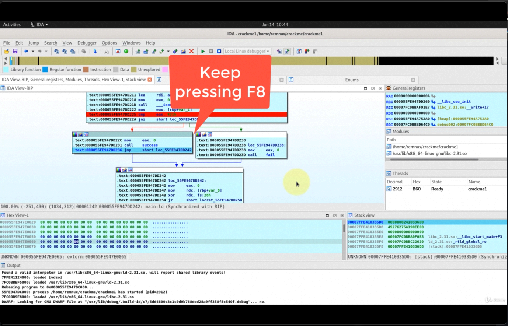
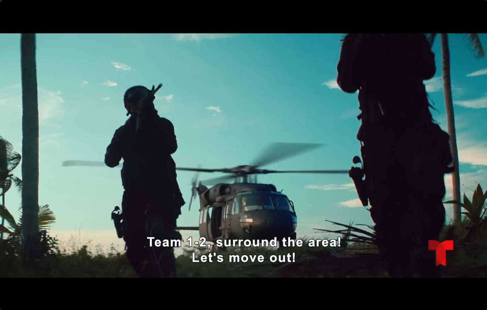
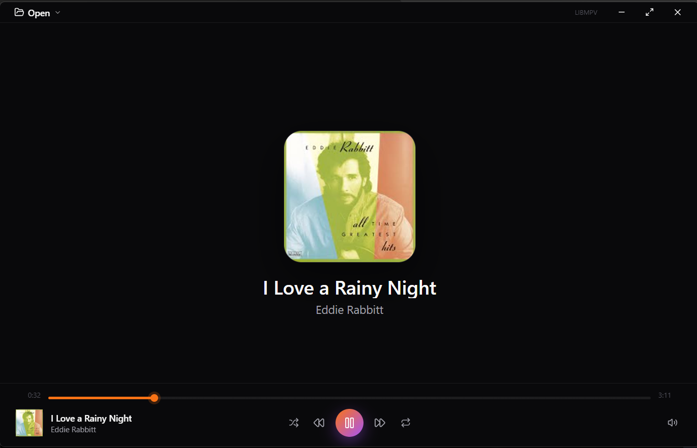

# Go Player

A modern, lightweight, cross-platform media player with an integrated
AI subtitle intelligence system: discover embedded/external subtitles,
generate subtitles from speech on-device, translate subtitle tracks
locally or via explicit cloud providers, and edit/synchronize/export
them — all offline-first once models are installed.







## Tech stack

| Layer          | Choice                                                     |
| -------------- | ---------------------------------------------------------- |
| Shell          | Tauri 2                                                    |
| Frontend       | Solid + TypeScript, Tailwind CSS v4, Kobalte UI primitives |
| Core logic     | Rust workspace (`crates/`)                                 |
| Playback       | libmpv (`go-media` abstraction) — see ADR-0001             |
| Speech-to-text | whisper.cpp (planned)                                      |
| Persistence    | SQLite (planned)                                           |
| Package mgrs   | pnpm (JS) + cargo (Rust), versions pinned via mise         |

Desktop (Windows, Linux, macOS) is the first target; Android/iOS come
later through Tauri 2 mobile.

## Prerequisites

- **Windows:** Visual Studio 2022 Build Tools with the _Desktop
  development with C++_ workload (provides the MSVC linker + Windows
  SDK). Node.js, Rust, and pnpm are installed by the setup script.
- **Linux/macOS:** Rust, Node.js 22+, pnpm. Tauri system libraries are
  listed in `scripts/setup.sh`.

## Setup

```powershell
# Windows (run from an elevated PowerShell if installs are needed)
.\scripts\setup.ps1
```

```bash
# Linux / macOS
./scripts/setup.sh
```

Both scripts are idempotent — they check what's installed and only
install what's missing, then run `pnpm install`.

### Optional: pinned tool versions with mise

[mise](https://mise.jdx.dev) pins Node/pnpm (`mise.toml`) and Rust is
pinned via `rust-toolchain.toml`:

```bash
mise install        # installs pinned node + pnpm
mise exec -- pnpm dev
```

## Development

```bash
pnpm dev            # tauri dev — Vite + Rust in watch mode
pnpm build          # production frontend build (vite)
pnpm tauri build    # full desktop bundle (MSI/NSIS/AppImage/...
```

Rust workspace checks:

```bash
cargo check --workspace
cargo test -p go-media
cargo clippy --workspace
```

## Repository layout

```text
apps/app/               # Tauri application (Solid frontend + src-tauri)
crates/go-media/        # PlaybackEngine trait + media domain types
packages/contracts/     # TypeScript IPC contract types (@go-player/contracts)
docs/decisions/         # Architecture decision records
.agents/skills/         # Agent skill definitions
scripts/                # setup.ps1 / setup.sh — idempotent env setup
```

New crates are added under `crates/` only when a real boundary exists —
see `AGENTS.md` §5.

## Documentation

- `AGENTS.md` — engineering principles, architecture boundaries, and
  workflow rules for contributors and AI agents.
- `.agents/skills/go-player-engineering/SKILL.md` — detailed engineering
  guidance for AI agents working on this repo.
- `docs/decisions/` — ADRs for significant technical decisions
  (e.g., `0001-playback-engine.md`).

## Status

**v1.0.0** — First stable release with desktop playback:

- ✅ Windows: Full video + audio playback
- ✅ Linux: Full video + audio playback (.deb package)
- ⚠️ macOS: Audio-only (video surface pending)

AI subtitle features (whisper.cpp, translation, model management) are
planned for future releases. See `CHANGELOG.md` for details.
