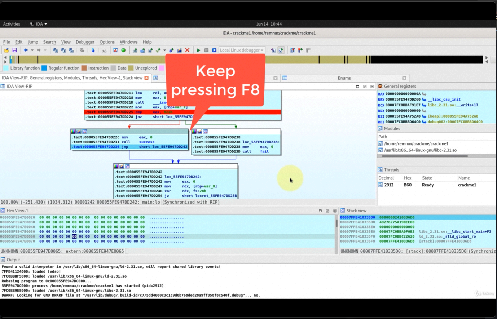
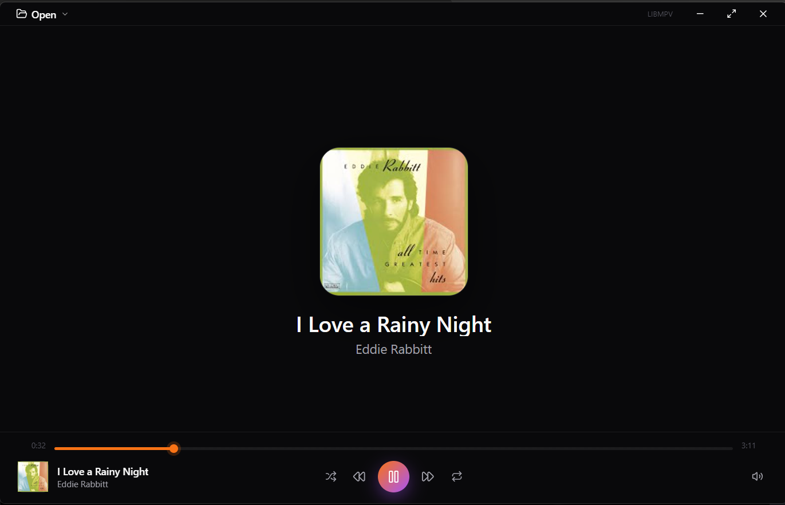
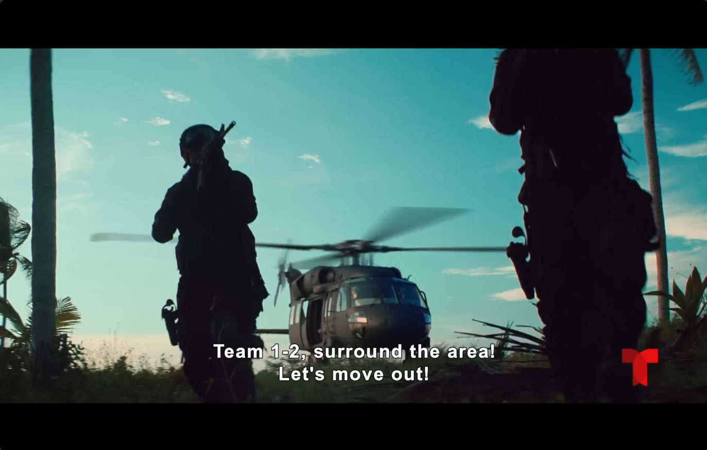

# Go Player v0.1.0

Initial release with cross-platform desktop playback.



## What's New

### Playback





- **Video**: H.264, VP9, AV1, and other common codecs via libmpv
- **Audio**: MP3, FLAC, WAV, OGG, M4A, AAC, WMA, Opus, AIFF
- **Subtitles**: SRT, WebVTT, ASS/SSA with external file loading
- **Cover art**: Automatic extraction from embedded tags
- **Controls**: Play/pause, seek, volume, mute, fullscreen

### Platform Support

| Platform | Status        | Package                                      |
| -------- | ------------- | -------------------------------------------- |
| Windows  | ✅ Full       | MSI / NSIS installer                         |
| Linux    | ✅ Full       | .deb (recommended) / AppImage (experimental) |
| macOS    | ⚠️ Audio-only | DMG (video surface pending)                  |

### UI/UX

- Modern dark-first design (Midnight / OLED / Light themes)
- Auto-hiding controls (3s idle)
- Keyboard shortcuts: Space, ←/→, ↑/↓, M, F, Ctrl+O
- Audio mode with cover art display
- Responsive layout for different window sizes

### Technical

- **Tauri 2** shell with **Solid + TypeScript** frontend
- **libmpv** playback engine with native video rendering
- **Native surfaces**: No decoded frames through JavaScript
- **Bundled libraries**: libmpv + FFmpeg + libass + libplacebo (Linux)
- **Offline-first**: No network required for playback

## Installation

### Windows

Download the MSI or NSIS installer from the release assets.

### Linux

Download the `.deb` package:

```bash
sudo dpkg -i go-player_0.1.0_amd64.deb
sudo apt-get install -f  # if dependencies are missing
```

Or build from source:

```bash
./scripts/setup.sh
pnpm tauri build
```

### macOS

Download the DMG (audio-only in this release).

## Known Issues

- **Linux VM (VMware svga)**: WebKitGTK GPU compositing may fail on weak GPUs; falls back to software rendering
- **macOS video**: Native video surface not yet implemented; audio playback only
- **Linux AppImage**: `linuxdeploy` may fail on some systems; use .deb instead

## What's Next

- macOS native video surface (CoreAnimation/Metal)
- AI subtitle generation (whisper.cpp integration)
- Subtitle translation (local + cloud providers)
- Model management (download, cache, license tracking)
- Playlist/queue management
- Playback history and statistics

## Links

- **Repository**: https://github.com/filippodesilva/go-player
- **Issues**: https://github.com/filippodesilva/go-player/issues
- **Documentation**: See `README.md` and `docs/` in the repository

---

Built with ❤️ using Tauri 2, Solid, TypeScript, Rust, and libmpv.
